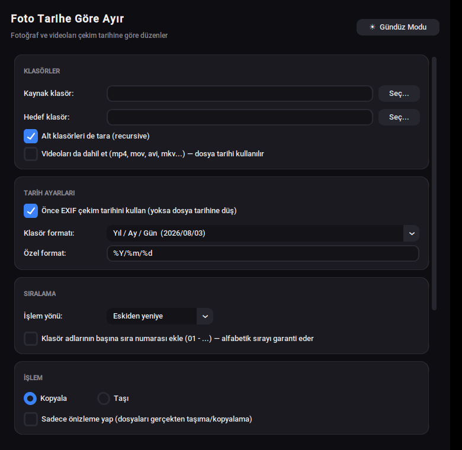

# Foto Tarihe Göre Ayır 📷🗂️

Bir klasördeki fotoğrafları (ve isteğe bağlı olarak videoları) çekim tarihine
(EXIF) veya dosya tarihine göre otomatik olarak klasörlere ayıran, gece/gündüz
temalı basit bir masaüstü uygulaması.




*(Not: Yukarıdaki görüntü Linux üzerinde alınmıştır; Windows ve macOS'ta yazı
tipleri sisteminizin kendi fontuyla — Segoe UI / San Francisco — daha
akıcı görünür.)*

## Özellikler

- 📅 EXIF çekim tarihi veya dosya değiştirilme tarihine göre ayırma
- 🎞️ Fotoğrafların yanı sıra video dosyalarını da dahil etme
- 🗓️ Hazır tarih formatları (Yıl/Ay/Gün, Yıl-Ay, sadece Yıl, Türkçe ay adı...)
  veya kendi `strftime` formatınızı yazma
- 📁 `/` ile alt klasör oluşturma desteği (örn. `%Y/%m` → 2026/08)
- 🔢 Klasör adlarına sıra numarası ekleyerek sıralamayı garanti altına alma
- ↔️ Kopyala veya taşı seçeneği
- 👀 Önizleme (dry-run) modu — hiçbir dosyayı değiştirmeden sonucu görme
- 🌙☀️ Gece / Gündüz modu

## İndirme (kurulum gerektirmez)

En güncel derlenmiş sürümleri **[Releases](../../releases)** sayfasından
indirebilirsiniz:

- **Windows** → `FotoTariheGoreAyir.exe`
- **Mac (Apple Silicon / M1, M2, M3, M4...)** → `FotoTariheGoreAyir-macOS-AppleSilicon.zip`

> Not: Intel Mac (x86_64) için ayrı bir derleme sunulmuyor — Apple ve GitHub
> Intel mimarisini kademeli olarak devre dışı bırakıyor. Eski bir Intel
> Mac'iniz varsa "Kaynaktan çalıştırma" bölümündeki adımlarla uygulamayı
> doğrudan çalıştırabilirsiniz.

Bu dosyalar benim bilgisayarımda değil, **GitHub Actions üzerinde bu
repodaki kaynak koddan otomatik olarak** derlenir. Derleme adımlarını ve
günlüklerini [Actions](../../actions) sekmesinden herkes görebilir —
yani "kaynağı belirsiz bir exe" değildir.

### macOS'ta ilk açılış uyarısı

macOS, imzasız uygulamalarda "geliştirici doğrulanamadı" uyarısı gösterir.
Bunu aşmak için:
1. `.zip` dosyasını açın, `FotoTariheGoreAyir.app` dosyasına **sağ tıklayıp
   "Aç"** deyin (çift tıklamayın).
2. Çıkan uyarıda tekrar **"Aç"** deyin. Bu işlemi sadece ilk açılışta
   yapmanız yeterli.

### Windows'ta ilk açılış uyarısı

Windows SmartScreen "Windows bu uygulamayı korudu" uyarısı gösterebilir.
**"Ek bilgi"** → **"Yine de çalıştır"** ile devam edebilirsiniz.

## Kaynaktan çalıştırma

```bash
pip install pillow customtkinter
python foto_tarihe_gore_ayir.py
```

## Kendi exe/app dosyanızı derlemek isterseniz

### Windows

```bat
pip install pillow customtkinter pyinstaller
pyinstaller --onefile --noconsole --collect-all customtkinter --name "FotoTariheGoreAyir" foto_tarihe_gore_ayir.py
```

### macOS

```bash
pip3 install pillow customtkinter pyinstaller
pyinstaller --windowed --collect-all customtkinter --name "FotoTariheGoreAyir" foto_tarihe_gore_ayir.py
```

> Not: `--collect-all customtkinter` bayrağı şart — CustomTkinter'ın yuvarlak
> köşe/tema görselleri için kullandığı ek veri dosyalarını da exe/app içine
> gömer. Bu bayrak olmadan derlenen exe açılışta hata verir.

> Not: PyInstaller derlemeyi yaptığı işletim sistemi ve mimari için üretir
> (cross-compile yapamaz). Yani Apple Silicon (M serisi) bir `.app` için
> derlemeyi bir Apple Silicon Mac'te yapmanız gerekir — bu repodaki GitHub
> Actions workflow'u bunu sizin için otomatik olarak yapar.

## Yeni bir sürüm yayınlamak (Release oluşturmak)

```bash
git tag v1.0.0
git push origin v1.0.0
```

Bu komut GitHub Actions'ı tetikler; Windows exe ve Apple Silicon için macOS
`.app` dosyası otomatik derlenip bir GitHub Release'e eklenir.

## Lisans

MIT — bkz. [LICENSE](LICENSE)
