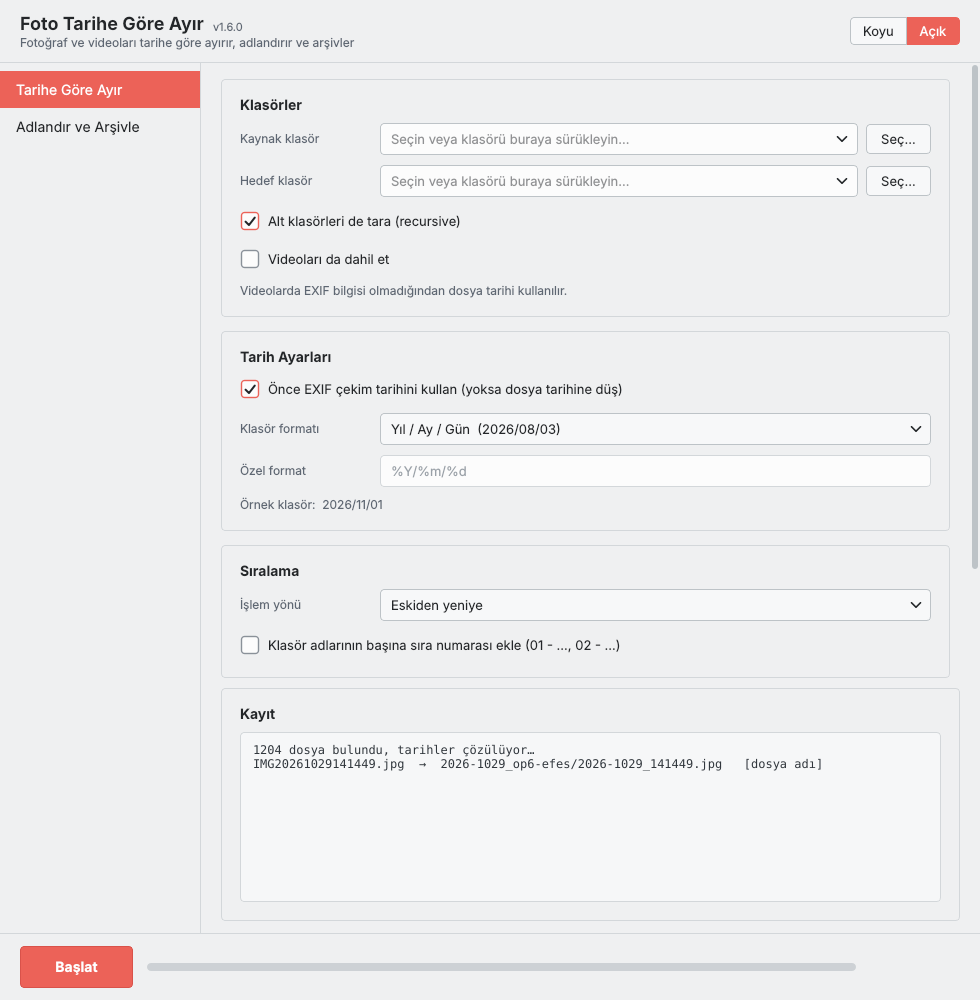
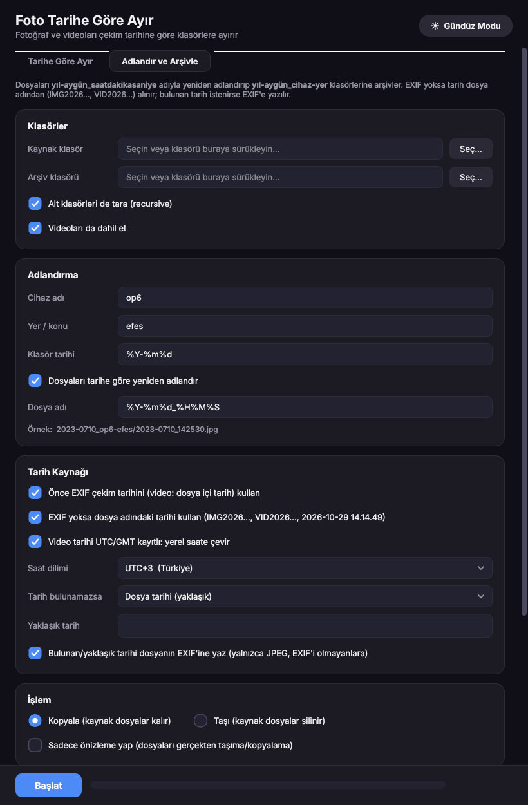
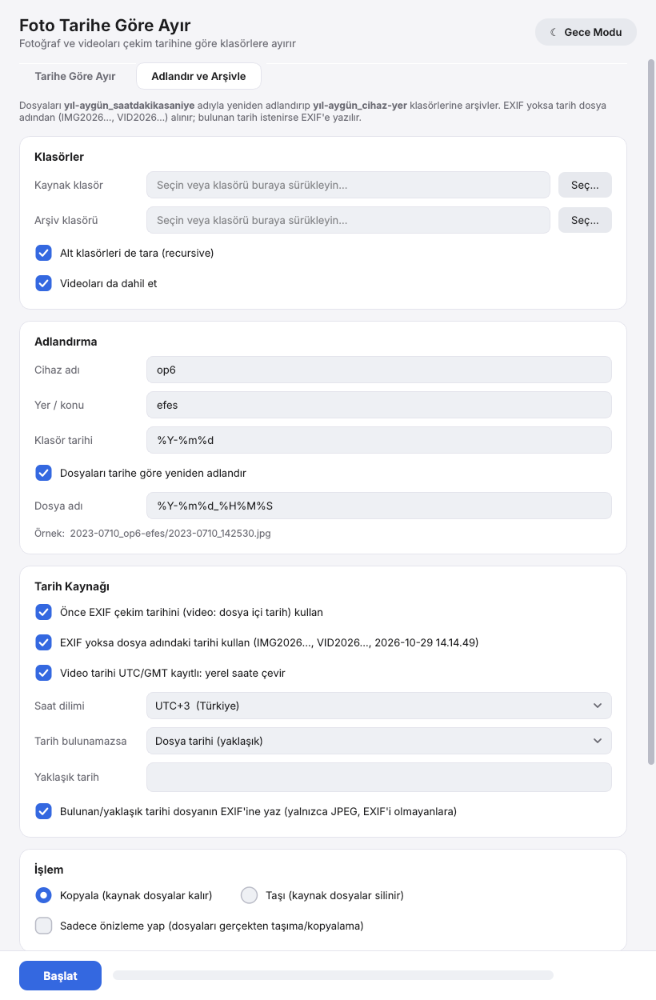

# Foto Tarihe Göre Ayır 📷🗂️

*(English below)*

Bir klasördeki fotoğrafları (ve isteğe bağlı olarak videoları) çekim tarihine (EXIF)
veya dosya tarihine göre otomatik olarak klasörlere ayıran, gece/gündüz temalı basit bir
masaüstü uygulaması. **PySide6 (Qt)** ile yazılmıştır.

> Fotoğraf dışındaki türleri (3D baskı dosyaları, belgeler, arşivler… veya tüm dosyalar)
> de ayırmak isterseniz genel amaçlı fork'a bakın:
> [**Dosya Türüne Göre Ayır**](https://github.com/BuRsTFiRe47/dosya-turune-gore-ayir)


<p>
  
  
</p>

## İki sekme

**1) Tarihe Göre Ayır** — tarih formatına göre klasörlere böler (aşağıdaki özellikler).

**2) Adlandır ve Arşivle** — arşiv düzeni isteyenler için:

- 🏷️ Dosyaları `yıl-aygün_saatdakikasaniye` adıyla yeniden adlandırır
  (örn. `2023-0710_142530.jpg`)
- 📁 `yıl-aygün_cihaz-yer` klasörlerine koyar (örn. `2023-0710_op6-efes`);
  cihaz adı ve yer/konu kutularından belirlenir
- 🔎 EXIF tarihi yoksa **dosya adından** okur (`IMG20261029141449.jpg`,
  `VID20261029224307.mp4`, `PXL_…`, `2026-10-29 14.14.49` …)
- 🎬 Video dosya içi tarihleri UTC/GMT kayıtlıdır: seçtiğiniz **saat dilimine** çevirir
  (Türkiye için UTC+3)
- ✍️ Tarih hiç bulunamazsa dosya tarihini veya elle girdiğiniz **yaklaşık tarihi** kullanır
  ve bulunan tarihi JPEG'in **EXIF'ine yazar** (yeniden sıkıştırma yok)
- 👀 Önizleme, 🔁 tekrar çalıştırma güvenliği, kopyala/taşı burada da geçerli

<p>
  
  
</p>

## Özellikler

- 📅 EXIF çekim tarihi (yoksa dosya değiştirilme tarihi) ile ayırma
- 🎞️ İsteğe bağlı video dahil etme (videolarda EXIF olmadığından dosya tarihi kullanılır)
- 🗓️ Hazır tarih formatları (Yıl/Ay/Gün, Yıl-Ay, sadece Yıl, Türkçe ay adı…) veya kendi
  `strftime` formatınız — altında **canlı örnek klasör adı** görünür
- 📁 `/` ile alt klasör oluşturma (örn. `%Y/%m` → `2026/08`)
- 🔢 Klasör adlarına sıra numarası ekleme (alfabetik sıralamayı garanti eder)
- ↔️ Kopyala veya taşı (taşırken onay sorar)
- 👀 Önizleme (dry-run) modu, ⏹️ **Durdur** düğmesi, 🧲 klasörü sürükleyip bırakma
- 🔁 Tekrar çalıştırmak güvenlidir: hedefte zaten aynısı olan dosyalar atlanır, hedef klasör
  tekrar taranmaz (`(1)` kopyaları oluşmaz)
- 🌙☀️ Gece / Gündüz modu (varsayılan: gece, seçiminiz hatırlanır)

## İndirme (kurulum gerektirmez)

**[Releases](https://github.com/BuRsTFiRe47/foto-tarihe-gore-ayir/releases)** sayfasından:

- **Windows** → `FotoTariheGoreAyir.exe`
- **Mac (Apple Silicon / M1, M2, M3, M4…)** → `FotoTariheGoreAyir-macOS-AppleSilicon.zip`

> Not: Uygulama Qt kütüphanelerini içerdiği için dosya boyutu büyüktür (yaklaşık 100 MB).
> Intel Mac için ayrı derleme yoktur; "Kaynaktan çalıştırma" ile çalıştırabilirsiniz.

Dosyalar **GitHub Actions üzerinde bu repodaki kaynak koddan otomatik olarak** derlenir —
adımları ve günlükleri [Actions](https://github.com/BuRsTFiRe47/foto-tarihe-gore-ayir/actions)
sekmesinden herkes görebilir.

**macOS ilk açılış:** `.zip` dosyasını açın, `FotoTariheGoreAyir.app` üzerinde **sağ tık → Aç**,
çıkan uyarıda tekrar **Aç** deyin.
**Windows ilk açılış:** SmartScreen uyarısında **Ek bilgi → Yine de çalıştır**.

## Kaynaktan çalıştırma

```bash
pip install PySide6 pillow piexif
python foto_tarihe_gore_ayir.py
```

## Kendi exe/app dosyanızı derlemek

```bash
pip install PySide6 pillow piexif pyinstaller

# Windows
pyinstaller --onefile --noconsole --name "FotoTariheGoreAyir" foto_tarihe_gore_ayir.py

# macOS
pyinstaller --windowed --name "FotoTariheGoreAyir" foto_tarihe_gore_ayir.py
```

> PyInstaller çapraz derleme yapamaz; her platformun paketini o platformda (ya da bu
> repodaki GitHub Actions ile) derlemeniz gerekir.

## Yeni sürüm yayınlamak

```bash
git tag v1.0.0
git push origin v1.0.0
```

Windows exe ve Apple Silicon `.app` otomatik derlenip bir GitHub Release'e eklenir.

## Lisans

MIT — bkz. [LICENSE](LICENSE)

---

## English

A dark/light-themed desktop app (built with **PySide6 / Qt**) that sorts the photos
(optionally videos too) of a folder into date-based folders using the EXIF capture date
or the file date.

Need other file types (3D-print files, documents, archives… or everything)? See the
general-purpose fork: [**Dosya Türüne Göre Ayır**](https://github.com/BuRsTFiRe47/dosya-turune-gore-ayir).

### Two tabs

The second tab, **Rename & Archive**, renames files to `year-monthday_hhmmss`
(e.g. `2023-0710_142530.jpg`) and files them into `year-monthday_device-place`
folders (e.g. `2023-0710_op6-efes`). If EXIF is missing the date is parsed from the file
name (`IMG20261029141449.jpg`, `VID20261029224307.mp4`, …); video dates (stored in UTC)
are converted to your time zone (UTC+3 for Turkey); and if nothing is found, the file date
or a date you enter is used as an approximate date and can be written into the JPEG's EXIF
without re-encoding.

### Features

- 📅 EXIF capture date (falls back to file modified date)
- 🎞️ Optional videos (no EXIF, so the file date is used)
- 🗓️ Built-in date-folder formats or a custom `strftime` pattern, with a **live example
  folder name**; nested subfolders via `/` (e.g. `%Y/%m`)
- 🔢 Optional sequence-number prefix on folder names
- ↔️ Copy or move (asks for confirmation), 👀 dry-run preview, ⏹️ Stop button,
  🧲 drag & drop folders
- 🔁 Safe to re-run: already-present files are skipped, the destination isn't re-scanned
- 🌙☀️ Dark / Light mode (defaults to dark, remembered)

### Download

**[Releases](https://github.com/BuRsTFiRe47/foto-tarihe-gore-ayir/releases)**: Windows
`FotoTariheGoreAyir.exe`, Mac (Apple Silicon) `FotoTariheGoreAyir-macOS-AppleSilicon.zip`.
Built by **GitHub Actions straight from this repo's source**; logs are public under
[Actions](https://github.com/BuRsTFiRe47/foto-tarihe-gore-ayir/actions). Files are large
(~100 MB) because they bundle Qt.

### Run from source

```bash
pip install PySide6 pillow piexif
python foto_tarihe_gore_ayir.py
```

### License

MIT — see [LICENSE](LICENSE)
